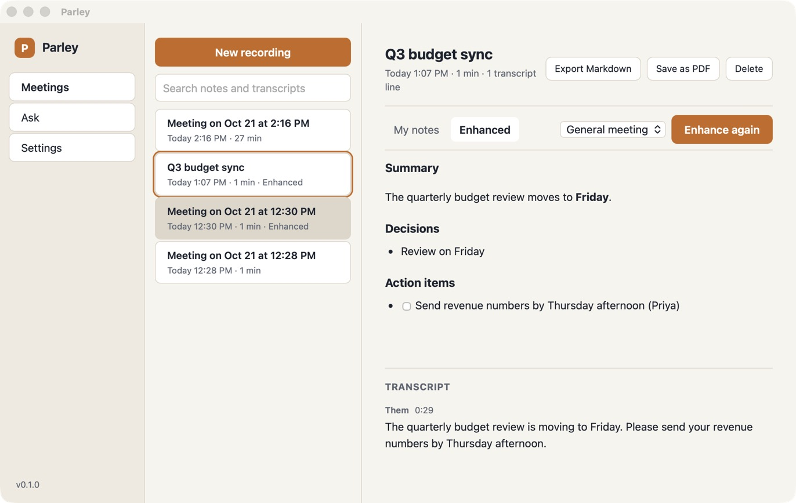

<p align="center"></p>

# Parley

Open-source AI meeting notes for macOS. Parley records your microphone and the call audio on your Mac, writes a live transcript, and turns your rough notes into clean ones after the meeting.

Parley captures audio on your Mac, so it works with Zoom, Google Meet, Teams, Slack huddles, FaceTime or anything else that plays sound, and no bot joins the call.

By default nothing leaves your Mac: whisper.cpp transcribes on device and Ollama writes the notes. If you want cloud quality, bring your own Deepgram, AssemblyAI, OpenAI-compatible or Anthropic key.

<p align="center"></p>

## What it does

- **Live transcript.** Your mic and the other side of the call are captured separately, labelled "You" and "Them", with macOS echo cancellation so speaker audio isn't transcribed twice.
- **Notes beside the transcript.** Type rough notes while you listen. After the meeting, Enhance rewrites them with detail from the transcript using a template: general meeting, 1:1, sales call, standup, or your own.
- **Folders.** Group meetings by client, team or project; search and Ask within a folder.
- **Calendar.** Upcoming meetings from the calendars on your Mac (Google, Outlook and iCloud included). Recordings take the event's title and attendees, and a weekly meeting files itself into the folder you used last time.
- **Library and search.** Every meeting is searchable by title, notes and transcript.
- **Ask your meetings.** Ask a question across past meetings and get an answer with numbered sources you can open.
- **Export.** Markdown file or PDF.
- **Stays out of the way.** Lives in the menu bar, starts and stops with ⌥⇧⌘R from any app, and can notify you when Zoom, Teams, Meet or another call app starts using the microphone.

## Privacy

- Transcripts and notes are stored in a SQLCipher-encrypted database. The key is generated on your Mac and kept in the macOS Keychain.
- Audio files are deleted once the transcript is saved, unless you turn on "Keep audio recordings".
- API keys live in the Keychain. The interface only learns whether a key is set.
- No accounts, analytics or telemetry.

[PRIVACY.md](PRIVACY.md) lists exactly what goes where for each provider.

## Install

1. Download the DMG for your Mac from [Releases](https://github.com/eshaanjain26/parley/releases/latest): `aarch64` for Apple silicon, `x64` for Intel.
2. Drag Parley to Applications and open it.
3. Allow microphone and system-audio access on the first recording, and choose Always Allow when macOS asks about the Keychain.

Requires macOS 14.4 or later.

Current builds are not yet notarized by Apple. macOS will say it can't check Parley for malicious software the first time. To open it anyway, go to System Settings > Privacy & Security, scroll to the message about Parley and click Open Anyway. Until builds are signed with a Developer ID, macOS also asks again for microphone and system-audio access after each update.

Parley checks GitHub for new versions shortly after launch and offers "Restart to update". Updates are signed, and Parley verifies each download before installing it. You can turn this off in Settings.

### Local AI setup

For on-device notes, install [Ollama](https://ollama.com) and pull a model:

```bash
ollama pull llama3.2:3b
```

The speech model (whisper `base.en`, 148 MB) downloads from inside Parley during setup.

## Build from source

You need macOS 14.4+, Xcode Command Line Tools, Node 22+, Rust stable and cmake.

```bash
npm install
npm run tauri dev
```

Tests:

```bash
npm test && (cd src-tauri && cargo test)
```

Release build:

```bash
npm run tauri build
```

The app lands in `src-tauri/target/release/bundle/macos/`.

### Signing dev builds

Unsigned builds get a new identity on every rebuild, so macOS asks again for microphone, system audio and Keychain access. Create a local code-signing certificate once (Keychain Access > Certificate Assistant > Create a Certificate, type "Code Signing", then set it to Always Trust for code signing) and build with it:

```bash
APPLE_SIGNING_IDENTITY="Parley Dev" npm run tauri build -- --debug --bundles app
```

### Releasing

1. `npm run set-version -- 0.2.0`, update [CHANGELOG.md](CHANGELOG.md), merge to `main`.
2. Push a tag: `git tag v0.2.0 && git push origin v0.2.0`.
3. The Release workflow builds both architectures into a draft GitHub release with DMGs, signed update bundles and `latest.json`. Check it, then publish.

The workflow needs the `TAURI_SIGNING_PRIVATE_KEY` and `TAURI_SIGNING_PRIVATE_KEY_PASSWORD` secrets. Adding `APPLE_CERTIFICATE`, `APPLE_CERTIFICATE_PASSWORD`, `APPLE_SIGNING_IDENTITY`, `APPLE_ID`, `APPLE_PASSWORD` and `APPLE_TEAM_ID` switches on Developer ID signing and notarization.

## How it works

- Tauri 2 app: Rust core, React and TypeScript interface.
- System audio comes from a Core Audio process tap (macOS 14.4+) in a small Swift helper; the mic uses AVAudioEngine voice processing for echo cancellation.
- Speech engines share one interface: whisper.cpp with Metal on device, or Deepgram and AssemblyAI streaming.
- Meeting detection reads which apps hold the microphone from the Core Audio process list. It never opens an audio stream.

## Security

See [SECURITY.md](SECURITY.md) to report a vulnerability.

## License

MIT. See [LICENSE](LICENSE). Bundled components and their licenses are listed in [THIRD-PARTY-NOTICES.md](THIRD-PARTY-NOTICES.md).
